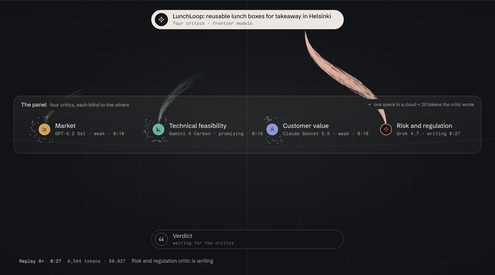
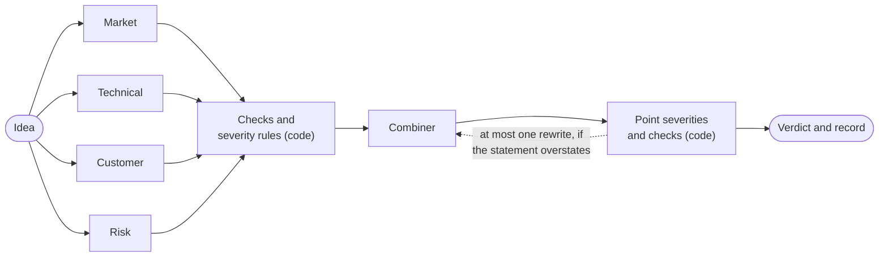

<div align="center">


# SkeptiC

**Four AI critics read an innovation idea, each from one angle and blind to the others.<br>
One verdict comes back: what is weak, and how to fix it.**

<a href="https://github.com/zimaBloo/SkeptiC/actions/workflows/checks.yml"></a>


</div>

<br>



<sub>A replay of a frontier run on [LunchLoop](ideas/lunchloop.md), a made-up test idea: three critics have answered, and Grok, the risk critic, is still writing. The whole run took 1:41 and cost $0.14.</sub>

SkeptiC is an MSc thesis project at the University of Helsinki, in the AI Engineering group. The thesis asks whether an AI critic of ideas can be trusted. So every issue a critic raises has to quote the idea, and every point in the verdict cites the issues behind it. Each run also keeps every prompt and model reply.

## How a run works



Each critic returns its issues as JSON, with the fields shown in the run record below: every issue quotes the idea and gets a severity (minor, major or fatal). The critics run on models from four labs.

Code then applies two rules a model could get wrong: an issue the critic calls fixable can't be fatal, and a critic's overall rating follows from its severities. The combiner groups the major and fatal issues into points by citing their ids (`market-2`, `risk-1`), notes where the critics disagree and writes the statement. It rates nothing: each point takes the highest severity of the issues it cites, so no point can be harsher or softer than the critics were.

Every reply is checked too, for example for a quote that isn't in the idea. The checks only flag problems in the log, with one exception: if the statement calls a problem fatal or not viable while no issue is rated fatal, the combiner is asked once to rewrite it.

| Critic | Looks at | Local model | Frontier model |
|---|---|---|---|
| Market | demand, competitors, price | Qwen 3.5 9B | GPT-6.2 Sol |
| Technical feasibility | can it be built as described? | Gemma 4 12B | Gemini 4 Carbon |
| Customer value | would customers pay, and stay? | Ministral 3 8B | Claude Sonnet 5.5 |
| Risk and regulation | law, privacy, safety | Nemotron 3 Nano 4B | Grok 4.7 |
| Combiner | writes the verdict | Gemma 4 12B | Claude Opus 5.5 |

Local models run on your own machine through [Ollama](https://ollama.com), so the idea stays private. They take turns, and a run took about nine minutes on the development Mac. Frontier models run side by side through [OpenRouter](https://openrouter.ai), with one key for all four labs. A run takes one to two minutes and cost $0.11 to $0.16 in November 2026.

## What comes back

> The most serious problem is that LunchLoop has not shown that its €0.40 per-use fee covers the cost of collecting, washing, redistributing and replacing boxes. That case rests on an untested 95% return rate whose losses are not costed, and on a 30-restaurant target with no basis. [...]
>
> First, build the unit economics and run a pilot that measures real return rates and paid uses per restaurant. [...]

<sub>The start of the verdict from the run in the screenshot.</sub>

## Quick start

You need [uv](https://docs.astral.sh/uv/), Node.js (22.22+, 24 or 26+) and either Ollama or an OpenRouter key.

```bash
uv sync                        # installs Python 3.14 and the dependencies
cp .env.example .env           # add OPENROUTER_API_KEY for frontier runs
npm --prefix web install
npm --prefix web run build
uv run skeptic serve           # then open http://127.0.0.1:8000
```

<details>
<summary>Setting up the local models</summary>

```bash
ollama pull qwen3.5:9b-q4_K_M
ollama pull gemma4:12b-it-qat
ollama pull ministral-3:8b-instruct-2512-q4_K_M
ollama pull nemotron-3-nano:4b-q4_K_M
OLLAMA_CONTEXT_LENGTH=8192 ollama serve
```

The combiner reads all four answers at once, so Ollama needs a context window of at least 8192 tokens.

</details>

<details>
<summary>Before a frontier run</summary>

- The idea leaves your machine, so use made-up or public ideas, like the ones in `ideas/`.
- The panel asks for low reasoning effort and allows 16,000 tokens per reply. Each call reserves that much, so a low prepaid balance can get calls refused; with auto top-up off, the balance caps what can be spent.
- Each model is called only through its own lab, under a price cap in `src/skeptic/lineups.py`. Above the cap a critic gives no answer and the others go on; if it's the combiner, the run fails.
- Two runs on the same idea can differ.

</details>

<details>
<summary>Command line and Inspect</summary>

```bash
uv run skeptic run ideas/shelfsense.md                     # local models
uv run skeptic run ideas/shelfsense.md --lineup frontier   # frontier models
uv run skeptic export logs/<run>.eval                      # the record of an earlier run
uv run skeptic schema                                      # the record's format as JSON Schema
uv run inspect view                                        # every prompt and reply, in Inspect's viewer
```

The panel is also an [Inspect](https://inspect.aisi.org.uk) task, with each critic and the combiner as a model role, so any of them can run on another model:

```bash
uv run inspect eval skeptic/skeptic_panel -T idea=ideas/shelfsense.md \
  --model-role risk=ollama/qwen3.5:9b-q4_K_M
```

That writes only the Inspect log; `skeptic export` turns it into a record.

</details>

## The run record

Each run leaves an Inspect log and the JSON record below, which for local models also names the exact model build. The command line writes the record next to its log in `logs/`; the web app writes it to `runs/<id>/record.json`.

```text
record.json
├─ idea, status, git commit, prompts hash
├─ critics (4): model, summary, rating, checks, time, tokens, cost
│  └─ issues: quote, what is wrong, why, how to fix, fixable?, severity
└─ combiner: model, statement, disagreements, checks, time, tokens, cost
   └─ points: text, critics, severity, the issue ids it cites
```

## First results

SkeptiC, the tool in this repository, reviews a business idea with four AI critics and merges their reviews into one verdict. It is built for an MSc thesis at the University of Helsinki, which asks whether such a panel reviews ideas better than one AI model on its own. A first small test, on 22 Nov 2026, says not yet: the panel did no better than Claude Opus 5.5 working alone, and it cost about twice as much.

### How the test worked

The test used 16 short, made-up business ideas, each with an answer key: a list of the problems planted in it, if any.

- 12 new ideas came in pairs: a sound idea, and a copy of it with one fatal flaw added, meaning a problem that can only be fixed by changing the core idea. In one copy, the paying customers are children aged 7 to 12, who can't hold a payment card or sign a subscription on their own. A separate Claude model checked the 12 and rejected 3 of the flawed copies as poor tests (the flaw was not clearly fatal, was flagged in the text, or the copy changed more than the flaw). Those 3 were still reviewed but aren't scored.
- 3 older ideas, written while SkeptiC was being built, had 13 planted weaknesses between them: problems a good review should name.
- 1 more older idea was sound. With the 6 sound originals, that makes 7 sound ideas, there to see whether a reviewer raises false alarms.

Three reviewers read every idea:

1. Panel: SkeptiC itself. Four critics each judge one side of the idea (market, technical, customer, risk), each on a model from a different company: GPT-6.2 Sol (OpenAI), Gemini 4 Carbon (Google), Claude Sonnet 5.5 (Anthropic) and Grok 4.7 (xAI). Claude Opus 5.5 merges their reviews into one verdict, and only that verdict was scored.
2. Opus with instructions: Claude Opus 5.5 alone, given all four critics' instructions in one prompt.
3. Opus plain: Claude Opus 5.5 alone, asked only "What is weak or risky about this idea, and how could it be better?"

The first two rate each problem minor, major or fatal; Opus plain has no set scale. The 12 new ideas were reviewed once each and the 4 older ones twice: 20 reviews per reviewer, 17 of them scored, and 60 reviews in all, which cost $5.09 not counting the grading.

Two AI models that none of the reviewers use, GPT-6.1 Terra (OpenAI) and Gemini 4 Hydrogen (Google), graded every review. Each marked which answer-key problems the review named, fully or partly, and whether it called the idea unworkable; for Opus plain they judged that from its wording. Where the two graders' counts differ, the table shows both, joined by "or".

### Results

| | Panel | Opus with instructions | Opus plain |
|---|:-:|:-:|:-:|
| Fatal flaws named, of 3 | 3 | 3 | 3 |
| ...and the idea called unworkable, of 3 | 1 | 2 | 3 |
| Weaknesses fully named, of 26 (13 weaknesses, each idea reviewed twice; more is better) | 18 or 22 | 23 | 25 |
| Weaknesses fully or partly named, of 26 | 24 or 25 | 23 | 25 or 26 |
| Sound ideas wrongly called unworkable, of 8 reviews (7 ideas, one reviewed twice; fewer is better) | 0 | 1 | 0 or 1 |
| Average cost of one review | 13 cents | 6 cents | 6 cents |
| Average time for one review | 79 s | 28 s | 36 s |

The panel fully named the fewest weaknesses, but counting partly named ones it was level with the other two. Part of the gap may be by design: the panel's merged verdict leaves out problems its critics rated minor. Opus plain named the most, but its reviews were 30 to 40% longer than the others, and the graders took nothing off for wrong or unneeded points, so a longer review had more chances to score.

Only one of the three fatal flaws is clear-cut: the children-as-customers idea, which every reviewer called unworkable. For the other two, the panel's critics who named the flaw judged it fixable without changing the core idea, and SkeptiC's instructions say a fixable problem is never fatal. Opus with instructions, under the same rule, still called one of them unworkable. The full report calls the answer key arguable for those two, which the check let through, so this row rests on one idea.

One part worked as designed. Every problem a critic raises must quote the idea, so a reader can check it against the idea's own words. Across its 20 reviews the panel's critics gave 313 quotes; SkeptiC's code checks each one, and 312 matched word for word. Opus with instructions, under the same rule, got 124 of 124.

### What it doesn't show

- The test is small: 17 scored reviews per reviewer.
- Claude models drafted the 12 new ideas, ran the check and are part of every reviewer, which may favour the two reviewers that are Claude alone.
- One of the three ideas with weaknesses was used earlier to tune SkeptiC's prompts.
- It left out two things SkeptiC is built for: whether critics on four companies' models catch more than four critics on one model, and running entirely on your own computer with free local models, which SkeptiC can also do.

The [full report](experiments/pilot-2026-11/report.md) has the details.

## Development

```
src/skeptic/           the panel, the single-model baselines, checks, run record, CLI, web API
src/skeptic/prompts/   every prompt the panel and the baselines send
web/                   the web interface (React, TypeScript, Vite)
ideas/                 sample ideas and their answer keys
experiments/           the pilot: ideas, answer keys, grading, results
tests/                 offline tests, including the panel end to end on mock models
```

```bash
uv run skeptic serve           # the API on port 8000
npm --prefix web run dev       # the interface on http://localhost:5173, reloads on every change
```

<details>
<summary>Tests GitHub runs on every push and pull request</summary>

```bash
uv run ruff check
uv run ruff format --check
uv run pyright
uv run pytest
npm --prefix web run typecheck
npm --prefix web test
```

GitHub also checks that the web app builds.

</details>

<br>

<sub>No licence yet.</sub>
